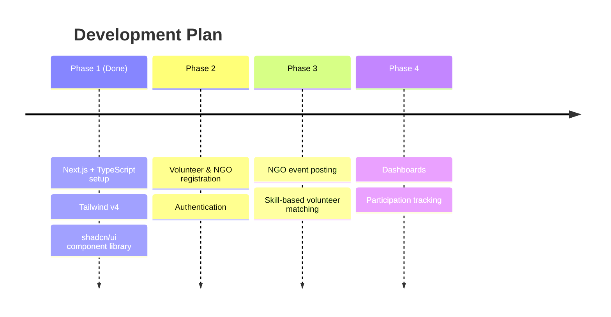

<div align="center">

# 🤝 Community Volunteer Platform

### *Connecting people who want to help with the causes that need them.*

A modern web platform concept that links volunteers with local NGOs, built on a Next.js 15 foundation with a complete, accessible UI component library.

<br>


[🐛 Report Bug](https://github.com/vaiii05/Community-Volunteer-Platform/issues) · [💼 LinkedIn](https://www.linkedin.com/in/vaibhavi-rai-2b6110357/)

</div>

---

## 📌 Overview

Small NGOs often struggle to find reliable volunteers, and willing volunteers don't know where to start. This project aims to bridge that gap with a single place where NGOs post opportunities and volunteers discover and join them.

> 🚧 **Status:** the frontend foundation and UI component library are complete. Backend, authentication and volunteer–event matching are in development.

---

## ✨ What's Built So Far

- ⚡ **Next.js 15 App Router** project with Turbopack dev server
- 🔷 **TypeScript** end to end, with ESLint configured
- 🎨 **Tailwind CSS v4** styling with animation utilities
- ♿ **Accessible components** built on Radix UI primitives

### 🧩 UI Component Library

| Component | Use |
|---|---|
| `Button` · `Badge` | Actions and status labels |
| `Card` · `Avatar` | Volunteer and NGO profiles |
| `Dialog` | Sign-up and apply flows |
| `Tabs` | Dashboard sections |
| `Select` · `Checkbox` · `Slider` | Filters and preferences |
| `Input` · `Textarea` | Forms |
| `Progress` | Participation and goal tracking |

---

## 🗺️ Roadmap



- [x] Project setup with Next.js 15, TypeScript and Tailwind v4
- [x] Reusable, accessible UI components
- [ ] Volunteer and NGO registration with authentication
- [ ] NGO event and opportunity posting
- [ ] Skill- and interest-based volunteer–event matching
- [ ] Volunteer dashboard with participation tracking

---

## 🛠️ Tech Stack

| Category | Technologies |
|---|---|
| **Framework** | Next.js 15 (App Router, Turbopack) |
| **Language** | TypeScript · React 19 |
| **Styling** | Tailwind CSS v4 · tw-animate-css · class-variance-authority |
| **Components** | shadcn/ui · Radix UI · lucide-react |
| **Tooling** | ESLint |

---

## 🚀 Getting Started

**Prerequisites:** Node.js 18.18 or later

```bash
# 1. Clone the repository
git clone https://github.com/vaiii05/Community-Volunteer-Platform.git
cd Community-Volunteer-Platform/volunteer-platform

# 2. Install dependencies
npm install

# 3. Start the dev server
npm run dev          # → http://localhost:3000
```

| Script | Purpose |
|---|---|
| `npm run dev` | Start the development server |
| `npm run build` | Create a production build |
| `npm start` | Serve the production build |
| `npm run lint` | Lint the codebase |

---

## 📁 Project Structure

```
Community-Volunteer-Platform/
└── volunteer-platform/
    ├── src/
    │   ├── app/              # Routes, layout, global styles
    │   ├── components/ui/    # Reusable UI components
    │   └── lib/utils.ts      # Helper utilities
    ├── public/               # Static assets
    ├── components.json       # shadcn/ui config
    └── next.config.ts
```

---

<div align="center">

**Built by [Vaibhavi Rai](https://github.com/vaiii05)**
B.Tech IT (AIML Hons.), Fr. CRIT, Vashi 🎓

[](https://www.linkedin.com/in/vaibhavi-rai-2b6110357/)

⭐ Star this repo to follow its progress!

</div>
